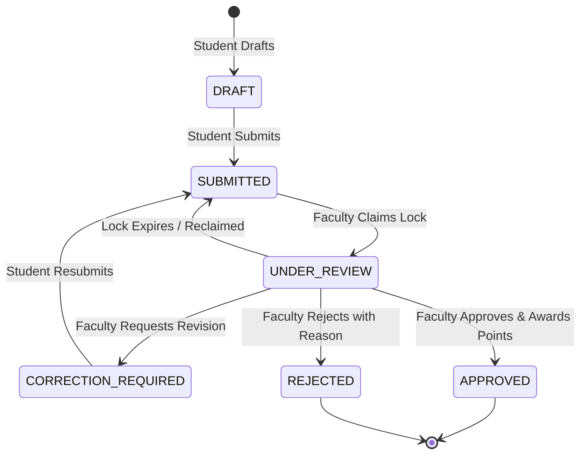
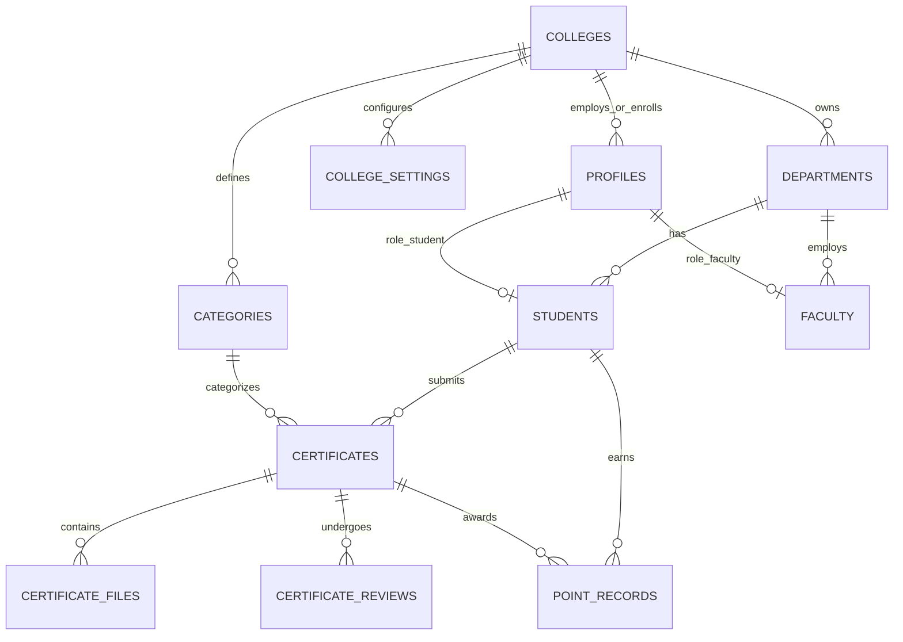

# NEC-SCS — Nandha Engineering College Student Credential System
> **CampusCred**: Verified Achievements. Trusted Institutional Records.

## 🚀 1-Click Permanent Cloud Deployment (24/7 Access)

[](https://vercel.com/new/clone?repository-url=https%3A%2F%2Fgithub.com%2FSDP-001%2FSDP-SCS)

Click the button above to deploy this entire application permanently to Vercel for free. It is online 24/7/365 with automatic SSL/HTTPS, global CDN, and installable on any phone or laptop.

---

[](https://nextjs.org/)
[](https://react.dev/)
[](https://www.typescriptlang.org/)
[](https://tailwindcss.com/)
[](https://supabase.com/)
[-blue)](https://nandhaengg.org)
[]()

---

## 📌 Executive Overview

**NEC-SCS (Nandha Engineering College — Student Credential System)**, also branded as **CampusCred**, is an institutional web platform designed for **Nandha Engineering College (Autonomous), Erode, Tamil Nadu**.

It replaces disorganized spreadsheets, lost paper certificates, and unverified claims with an **end-to-end faculty-verified achievement pipeline**, **cryptographic SHA-256 duplicate detection**, and a **tamper-evident student digital passport**. The system automates compliance data collection for **NAAC (Criteria 3 & 5)**, **NBA**, and **NIRF** accreditation frameworks.

### The Problem It Solves
- **Certificate Forgery & Resubmission**: Byte-level duplicate detection prevents students from submitting identical certificate files or re-using peer credentials across departments.
- **Spreadsheet Chaos**: Eliminates error-prone manual Excel record collection during accreditation audits.
- **Evaluation Bottlenecks**: Concurrency locks prevent duplicate faculty claims and race conditions with auto-release timers.
- **Accreditation Overhead**: Instant single-click CSV/PDF exports for UG & PG departments with full audit logs.

---

## 🌟 Core System Highlights

| Feature | Description |
| :--- | :--- |
| **Multi-Tier Role Architecture** | Dedicated portals for **Student**, **Faculty Reviewer**, **Head of Department (HOD)**, and **Dean / Admin**. |
| **Unified Institutional Sign In** | Direct authentication using Register Number, Employee ID, or official email with automatic routing to the user's authorized dashboard. |
| **SHA-256 Duplicate File Detection** | Calculates byte-level cryptographic hashes on certificate upload to flag duplicate submissions across the college. |
| **Review Workbench & Claim Locks** | Faculty claim certificates with an automated timeout (default 30 mins) to prevent concurrent review conflicts. |
| **Granular Evaluation Workflow** | Approve with credit points, request student revisions with specific remarks, or reject with clear justification. |
| **UG & PG Department Isolation** | Distinct governance for Undergraduate (B.E., B.Tech) and Postgraduate (M.E., MBA, MCA) programs. |
| **Digital Achievement Passport** | Gamified student profile with earned credit points, activity leaderboard, and exportable verification records. |
| **Accreditation SSR Engine** | One-click report generator formatted for NAAC Criteria 3.4/5.3 and NIRF institutional portfolios. |
| **Dual Persistence Engine** | Runs zero-config out of the box using an in-memory persistent store (`lib/db/store.ts`) or connects directly to Supabase PostgreSQL. |
| **Dual-Mode Student Enrollment** | Enroll students individually via **Manual Form** with real-time DB verification, or in bulk via **Excel / CSV Sheet Upload** (`.xlsx`, `.xls`, `.csv`). |
| **Database Verification & Auto-Correction** | Institutional verification engine checks Register Numbers against DB, auto-resolves branch aliases (e.g. `CSE`, `Mechanical`, `MCA`), and auto-formats official emails. |
| **Offline-Ready PWA** | Progressive Web App compliant with service worker caching (`sw.js`) and app manifest (`manifest.json`). |

---

## 🏛️ System Architecture

```
┌────────────────────────────────────────────────────────────────────────┐
│                        NEXT.JS 16 APP ROUTER                           │
├───────────────────┬───────────────────┬───────────────┬────────────────┤
│      STUDENT      │      FACULTY      │      HOD      │     ADMIN      │
│  /student/*       │  /faculty/*       │  /hod/*       │  /admin/*      │
│  - Upload Certs   │  - Review Queue   │  - Dept Stats │  - UG/PG Mgmt  │
│  - Track Status   │  - Claim Locks    │  - Branch SSR │  - Categories  │
│  - Digital Pass   │  - Lightbox View  │  - Approvals  │  - Audit Logs  │
│  - Leaderboard    │  - Score Points   │  - CSV Export │  - Settings    │
└───────────────────┴───────────────────┴───────────────┴────────────────┘
                                    │
                                    ▼
┌────────────────────────────────────────────────────────────────────────┐
│                   NEXT.JS SERVER ACTIONS & API LAYER                   │
│   actions/auth.ts  •  actions/certificates.ts  •  actions/reviews.ts   │
│   actions/admin.ts •  actions/points.ts        •  /api/reports/export  │
└───────────────────────────────────┬────────────────────────────────────┘
                                    │
                  ┌─────────────────┴─────────────────┐
                  ▼                                   ▼
┌───────────────────────────────────┐   ┌────────────────────────────────┐
│      LOCAL RUNTIME STORE          │   │      SUPABASE POSTGRESQL       │
│  (lib/db/store.ts - Zero Config)  │   │  (Migrations 001 - 005 + RLS)  │
│  - In-memory Node global          │   │  - Row-Level Security Policies │
│  - Pre-seeded realistic data      │   │  - Stored Procedures & Triggers│
│  - Instant dev server boot        │   │  - Storage Bucket with Hash DB │
└───────────────────────────────────┘   └────────────────────────────────┘
```

---

## 👥 Role Matrix & Workflows

### 1. 🎓 Student Portal (`/student`)
- **Submit Achievements**: Enter event level (*College, District, State, National, International*), title, organizer, date, and upload primary certificate + supporting files.
- **Duplicate Protection**: File upload runs SHA-256 hash extraction. If byte-identical to any existing certificate in NEC's repository, a warning is displayed.
- **Status Tracking**: Status badges: `DRAFT` ➔ `SUBMITTED` ➔ `UNDER_REVIEW` ➔ `APPROVED` / `CORRECTION_REQUIRED` / `REJECTED`.
- **Resubmission on Correction**: If faculty requests changes, students can edit details or re-upload files without losing history.
- **Credit Portfolio**: Visual dashboard of cumulative credit points, category breakdown (Academic, Technical, Hackathon, Sports, etc.), and department rank.

### 2. 👨‍🏫 Faculty Reviewer Portal (`/faculty`)
- **Department Verification Queue**: Filter submissions by status, category, and date.
- **Review Locking**: Claiming a certificate assigns `UNDER_REVIEW` status and locks it to that faculty member for 30 minutes, preventing duplicate reviews.
- **Secure Certificate Lightbox**: In-browser document viewer with zoom, rotation, and cryptographic metadata verification.
- **Evaluation Action**:
  - **Approve**: Award credit points (0 to institution max cap) with reviewer remarks.
  - **Request Correction**: Send item back to student with instructions for what needs updating.
  - **Reject**: Mark as invalid with an official audit reason.

### 3. 🏢 Head of Department Portal (`/hod`)
- **Department Oversight**: Full visibility across all faculty reviewers and students in the department.
- **Reclaim Stale Locks**: Unlock certificates if a reviewer has held a lock past the timeout.
- **Performance Analytics**: Real-time charts of submissions, approval rates, category distributions, and top student performers.
- **Department Reports**: Export filtered CSV/PDF reports for departmental IQAC meetings.

### 4. 🛡️ Dean & Administrator Portal (`/admin`)
- **Engineering Governance**: Separate management of **Undergraduate (UG)** and **Postgraduate (PG)** branches.
- **Achievement Categories**: Add, edit, or toggle categories (e.g., Hackathon, Research, Cultural, Sports).
- **Institution Settings**: Configure global parameters such as max points per certificate, reviewer lock duration (minutes), and file upload limits (MB).
- **Audit Logs**: Tamper-evident ledger logging all security and state events (logins, submissions, claims, approvals, point corrections, configuration updates).
- **NIRF / NAAC SSR Export**: Comprehensive report engine filtering by academic year, degree type (UG/PG), and category.

---

## 🔄 Certificate Lifecycle State Machine



---

## 📊 Database Schema & Data Models

### Key Tables Overview



### Enumeration Types
- **`UserRole`**: `STUDENT` | `FACULTY` | `HOD` | `ADMIN`
- **`DepartmentType`**: `UG` | `PG`
- **`CertificateStatus`**: `DRAFT` | `SUBMITTED` | `UNDER_REVIEW` | `CORRECTION_REQUIRED` | `APPROVED` | `REJECTED`
- **`EventLevel`**: `COLLEGE` | `INTRA_COLLEGE` | `INTER_COLLEGE` | `DISTRICT` | `STATE` | `NATIONAL` | `INTERNATIONAL` | `OTHER`
- **`ReviewAction`**: `CLAIMED` | `CORRECTION_REQUESTED` | `APPROVED` | `REJECTED` | `RECLAIMED`
- **`AuditAction`**: `LOGIN` | `CERTIFICATE_CREATED` | `CERTIFICATE_SUBMITTED` | `CERTIFICATE_CLAIMED` | `CERTIFICATE_RECLAIMED` | `CERTIFICATE_APPROVED` | `CORRECTION_REQUESTED` | `CERTIFICATE_REJECTED` | `POINTS_AWARDED` | `USER_CREATED` | `CONFIGURATION_CHANGED`

---

## 🚀 Quick Start Guide

### Prerequisites
- **Node.js**: v18.18.0 or higher (Node 20+ recommended)
- **Package Manager**: npm (v9+) or pnpm / yarn

### 1. Installation
Clone the repository and install dependencies:
```bash
# Navigate to the project directory
cd NEC-SCS-main

# Install dependencies
npm install
```

### 2. Environment Setup
The application is pre-configured to work immediately with the in-memory mock store without any third-party credentials. To connect to Supabase:

Copy the environment example file:
```bash
cp .env.example .env.local
```

Configure your variables in `.env.local`:
```env
NEXT_PUBLIC_SUPABASE_URL=https://your-project.supabase.co
NEXT_PUBLIC_SUPABASE_ANON_KEY=your-anon-key-here
SUPABASE_SERVICE_ROLE_KEY=your-service-role-key-here
NEXT_PUBLIC_APP_URL=http://localhost:3000
```

### 3. Database Migrations (Supabase Production)
When deploying to Supabase, run the migration scripts in order from the SQL Editor:
1. `supabase/migrations/001_initial_schema.sql` — Tables, constraints, and indexes
2. `supabase/migrations/002_rls_policies.sql` — Row-Level Security policies
3. `supabase/migrations/003_functions_triggers.sql` — Triggers for hashing & points
4. `supabase/migrations/004_seed_data.sql` — Seed colleges, departments & test accounts
5. `supabase/migrations/005_department_type_ug_pg.sql` — UG/PG department separation

### 4. Running the Development Server
```bash
npm run dev
```
Open **[http://localhost:3000](http://localhost:3000)** in your browser.

---

## 🔑 Demo Accounts & Pre-Configured Credentials

You can log in directly using the **1-Click Quick Demo Switcher** on the landing page, or use the credentials below:

| Role | Name & Department | Login Email / Register No | Default Password | Target Dashboard |
| :--- | :--- | :--- | :--- | :--- |
| **Student** | Aditya Verma (CSE - UG) | `aditya.verma@student.abctech.edu`<br>*(or reg no `NEC21CS042`)* | `password123` | `/student/dashboard` |
| **Faculty** | Prof. Ramesh Sharma (CSE) | `prof.sharma@abctech.edu`<br>*(or emp id `NEC-FAC-011`)* | `password123` | `/faculty/dashboard` |
| **HOD** | Dr. Murugan Pillai (HOD - CSE) | `hod.cse@abctech.edu` | `password123` | `/hod/dashboard` |
| **Dean / Admin**| Dr. Arthur Vance (Dean / Admin) | `admin@abctech.edu` | `password123` | `/admin/dashboard` |

> 💡 **Tip**: The login action supports institutional domain aliases: `@nandhaengg.org`, `@nandha.edu`, `@nec.edu.in`, and `@abctech.edu`.

---

## 🧪 Automated Verification Test Suite

The repository includes an end-to-end HTTP test runner verifying authentication cookies, SSR responses, SVG seals, and PWA health:

```bash
# Ensure dev server is running on localhost:3000, then execute:
node scripts/test-automation.mjs
```

### Verified Test Cases:
- [x] **TEST 1**: PWA Manifest verification (`/manifest.json`)
- [x] **TEST 2**: Service Worker availability (`/sw.js`)
- [x] **TEST 3**: Public Landing Page branding & location
- [x] **TEST 4**: Login Page branding & authentication fields
- [x] **TEST 5**: Faculty Review Queue (`/faculty/reviews`)
- [x] **TEST 6**: Certificate Detail / Review Workbench with Full View & SHA-256 metadata
- [x] **TEST 7**: Certificate Image / Document Download Route with official NEC Seal SVG
- [x] **TEST 8**: Admin Engineering Departments Hub (UG/PG governance)
- [x] **TEST 9**: Admin Executive Dashboard
- [x] **TEST 10**: Student Dashboard & register number verification

---

## 📂 Project Structure

```
NEC-SCS-main/
├── actions/                         # Next.js Server Actions
│   ├── admin.ts                     # Department, settings, user management actions
│   ├── auth.ts                      # Multi-identifier login, logout, and session check
│   ├── certificates.ts              # Creation, SHA-256 check, submission actions
│   ├── notifications.ts             # In-app notification actions
│   ├── points.ts                    # Point history and student balances
│   └── reviews.ts                   # Claim locks, approve, correct, reject actions
├── app/                             # Next.js App Router
│   ├── (auth)/                      # Login and password recovery routes
│   ├── admin/                       # Admin portal (analytics, audit, depts, users, settings)
│   ├── faculty/                     # Faculty reviewer portal (queue, workbench, students)
│   ├── hod/                         # Head of Department portal (analytics, SSR reports)
│   ├── student/                     # Student portal (achievements, passport, submit)
│   ├── api/                         # API route handlers
│   │   ├── files/download/route.ts  # Watermarked SVG preview & certificate download
│   │   └── reports/export/route.ts  # CSV export endpoint for NAAC/NIRF data
│   ├── layout.tsx                   # Root HTML shell & provider layout
│   └── page.tsx                     # Institutional portal landing page
├── components/                      # Reusable React components
│   ├── certificates/                # Certificate card, lightbox, review workbench
│   ├── charts/                      # Recharts visualizations (trends, category charts)
│   ├── dashboard/                   # Metric cards, quick actions, role banners
│   ├── forms/                       # Certificate submission & correction forms
│   ├── layout/                      # Navbar, Sidebar, CampusCred logo, MobileNav
│   ├── mobile/                      # Mobile bottom navigation & PWA components
│   ├── students/                    # Student table, passport card, add student modal
│   └── ui/                          # Button, badge, dialog, tabs, dropdown primitives
├── lib/                             # Core utilities and business logic
│   ├── audit/                       # Tamper-evident audit logger
│   ├── auth/                        # Cookie-based session resolution
│   ├── db/                          # In-memory database store & initial state
│   ├── notifications/               # Notification dispatcher
│   ├── storage/                     # SHA-256 cryptographic hash utilities
│   └── validators/                  # Zod validation schemas
├── public/                          # Static assets, SVG seals, PWA manifest & worker
│   ├── manifest.json                # PWA web app manifest
│   └── sw.js                        # Service worker
├── scripts/                         # Automation & verification scripts
│   ├── test-automation.mjs          # End-to-end integration test suite
│   └── test_dept.ts                 # Department regression test script
├── supabase/                        # Database migrations & seed scripts
│   └── migrations/                  # SQL migrations 001 through 005
├── types/                           # TypeScript interfaces & database schemas
│   └── database.types.ts            # Generated & domain entity types
├── next.config.ts                   # Next.js configuration
├── package.json                     # Project manifest and scripts
├── tailwind.config.ts               # Custom styling tokens and color scheme
└── tsconfig.json                    # TypeScript compiler configuration
```

---

## 🔒 Security & Data Integrity

1. **Cryptographic SHA-256 Verification**:
   - Every uploaded certificate has its binary content hashed using SHA-256 upon submission.
   - The hash is indexed and cross-checked across the institution to flag duplicate or previously submitted files.
2. **Review Concurrency Control**:
   - When a faculty member opens a certificate for evaluation, an exclusive lock is acquired (`reviewer_id` and `review_started_at`).
   - If another reviewer opens the record, they receive a warning that the submission is currently under review by another faculty member.
   - Locks automatically expire after 30 minutes (configurable in College Settings) or can be reclaimed by HODs.
3. **Role-Based Server-Side Guard Rails**:
   - All server actions strictly check caller roles using `requireRole(["STUDENT"])`, `requireRole(["FACULTY", "HOD"])`, or `requireRole(["ADMIN"])`.
   - Unauthorized invocations throw immediate permission errors.
4. **Comprehensive Audit Trail**:
   - Every critical event (`LOGIN`, `CERTIFICATE_SUBMITTED`, `CERTIFICATE_CLAIMED`, `CERTIFICATE_APPROVED`, `POINTS_AWARDED`, etc.) is logged with timestamp, actor profile ID, entity type, and metadata in the `audit_logs` table.

---

## 📜 Accreditation Compliance Mapping

| Regulatory Body | Metric / Criteria | NEC-SCS Capability |
| :--- | :--- | :--- |
| **NAAC** | **Criteria 3.4**: Research & Innovation | Captures paper publications, journal submissions, and patent filings with proof verification. |
| **NAAC** | **Criteria 5.3**: Student Participation & Activities | Tracks inter/intra-collegiate sports, technical symposiums, and cultural awards with automated SSR CSV export. |
| **NIRF** | Student Achievements & Quality Metric | Department-wise verified achievement counts and credit score distribution. |
| **Autonomous IQAC** | Continuous Student Performance Record | Digital Student Passport exportable with official college verification watermark. |

---

## 📄 License & Attribution

Developed for **Nandha Engineering College (Autonomous), Erode, Tamil Nadu**.  
Licensed under the [MIT License](LICENSE).  
*Copyright © 2026 Nandha Engineering College. All rights reserved.*